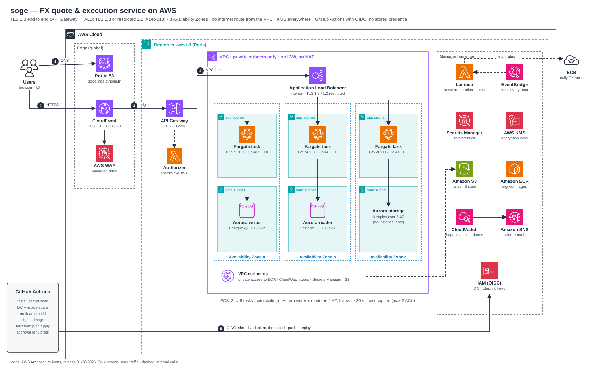
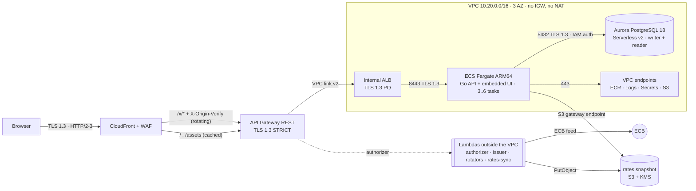

# soge — FX quote & execution service on AWS

A small production-ready application: live FX quotes (ECB reference rates) that a user can **lock for 15 s and execute**. Every execution is recorded **exactly once**, even when the client retries, the network drops or the database fails over.

The business scope is deliberately small. The engineering is the point: **3-AZ high availability, a VPC with no route to the internet, TLS 1.3 on every hop (browser → database), customer-managed KMS keys with rotation everywhere, no secret in the Terraform state, least-privilege IAM, SLO-driven operations and a load test that proves the scaling.**

---

## 1. Architecture



Request path (simplified):



| Layer | Choice | Why |
|---|---|---|
| Edge | CloudFront `TLSv1.3_2025`, HTTP/2 + HTTP/3, AWS WAF (managed rules), security headers | Single public entry point; TLS 1.3 only; L7 protection |
| API | API Gateway REST, TLS 1.3-only policy (STRICT), Lambda REQUEST authorizer, VPC link v2 | Only API Gateway flavour combining TLS 1.3-only, WAF and Lambda authorizers |
| Compute | ECS Fargate on Graviton, 3 small tasks (0.25 vCPU, one per AZ) → 6, Go binary with the UI embedded | Fully containerized, no servers to patch, ~20% cheaper on ARM |
| Data | Aurora PostgreSQL 18 Serverless v2, writer + reader in 2 AZ (0.5–2 ACU each), isolated subnets in 3 AZ | Failover ≈ 30 s, storage replicated 6 ways over 3 AZ, cost capped |
| Network | Dedicated VPC (the default VPC is not used), 4 tiers, **no IGW, no NAT**, NACL per tier, SG-to-SG only | Nothing in the VPC can reach the internet |
| Identity | 5-min JWT renewed silently, signing key rotated every 4 h, IAM database authentication | Short-lived credentials everywhere |

Full detail: **[docs/ARCHITECTURE.md](docs/ARCHITECTURE.md)** · decisions: **[docs/DECISIONS.md](docs/DECISIONS.md)**.

## 2. Run it locally (no AWS)

```bash
make env     # generates local-only secrets into .env (gitignored): the repo contains no credential
make up      # postgres + migration + API/UI → https://localhost:8443 (TLS 1.3 only, self-signed)
make smoke   # end-to-end: UI, TLS 1.2 refused, headers, session, quote, deal, idempotent retry, 422
make outage  # database crash: quotes 200, deals 503 + Retry-After, then exactly-once after recovery
make test    # Go (race detector) + Python unit tests
make lint    # same static checks as CI (gitleaks, terraform, tflint, trivy, hadolint)
make image   # multi-arch build (amd64 + arm64) + Trivy scan of the image
make down
```

Only Docker is required: tests run in `golang:1.27` / `python:3.14-slim`, and the checks use a small curl + jq container (macOS curl lacks `--tlsv1.3`). `make smoke TARGET=https://soge.labs.athoria.fr` runs the same checks against AWS.

Locally, API Gateway and the authorizer are replaced by `DEV_AUTH=true` (fixed subject) and the API talks to Postgres with a generated password. Rates come straight from the ECB feed. It is the same binary and the same image as in AWS, with the same TLS 1.3 listener.

## 3. Build and deploy

**Prerequisites:**
- an AWS account reached with **temporary credentials only**: `aws login` (console credentials, AWS CLI ≥ 2.32) or IAM Identity Center; never an access key;
- a delegated public Route 53 hosted zone in that account, referenced by its **zone ID**;
- the GitHub repository `soge`;
- `make doctor` passes (tools, temporary session, region, quotas, DNS delegation).

**One-time bootstrap** (≈ 2 min). AWS must trust GitHub before GitHub can authenticate, so this single step runs with a temporary admin session (`aws login` locally, or AWS CloudShell); everything after it runs in GitHub Actions with OIDC.

```bash
cd infra/bootstrap
cp terraform.tfvars.example terraform.tfvars   # owner, github_repository, github_sub_prefix (immutable OIDC subject)
terraform init && terraform apply
sed "s/<account_id>/$(aws sts get-caller-identity --query Account --output text)/" backend.tf.example > backend.tf
terraform init -migrate-state                  # the bootstrap state moves into its own encrypted bucket
```

Names are deterministic (`soge-tfstate-<account_id>`, `alias/soge-state`, `soge-gha-{plan,push,apply}`), so nothing has to be copied from outputs.

Then `scripts/github-setup.sh` configures the repository:
- **No credential anywhere**: CI authenticates to AWS with OIDC (short-lived, per job, per role).
- The repository and its logs are public, so the three *identifiers* (account ID, hosted zone ID, alarm e-mail) are Actions **secrets**: GitHub masks them in every log line, and `mask-aws-account-id` hides the account ID from AWS output. They grant nothing on their own; role ARNs, state bucket and ECR URL are derived from the account ID. Plain variables: `OWNER` (GitHub login), `DEPLOY_ENABLED`.
- the protected `prod` environment (required reviewer, `main` only);
- secret scanning with push protection;
- read-only default token permissions;
- an allow-list of actions (GitHub, AWS, and the pinned vendors used here).

**Every change** goes through one pipeline (`.github/workflows/ci.yml`):

| Stage | What happens |
|---|---|
| PR | Go/Python tests · gitleaks · `terraform fmt/validate` · tflint (deprecations + the 5 mandatory tags) · Trivy IaC scan · Trivy dependency scan · hadolint · multi-arch build · `terraform plan` (read-only role) posted on the PR |
| merge to `main` | Build `linux/amd64` + `linux/arm64` without emulation, SBOM + SLSA provenance · push **by digest** · Trivy image gate · cosign keyless signature |
| approval (`prod`) | Signature verified · migrations (one-shot Fargate task) · `terraform apply` · wait for steady state · smoke test (also asserts that TLS 1.2 is refused) |
| manual | `load-test` workflow: k6 against the public URL, thresholds = SLOs · `destroy` workflow (typed confirmation + approval) |

No AWS access key exists anywhere: GitHub authenticates through OIDC with three roles (`plan` read-only, `push` ECR only, `apply` protected environment only).

## 4. No credential anywhere

| Where | How |
|---|---|
| Laptop → AWS | `aws login` or IAM Identity Center: 15-min credentials, refreshed automatically. `make doctor` fails on long-term keys |
| GitHub Actions → AWS | OIDC, 3 roles scoped by repository, branch and environment; 1 h sessions |
| Image signing | cosign keyless (Sigstore + GitHub OIDC): no signing key to store |
| Application → database | IAM authentication: 15-min token per connection, no password |
| Secrets in AWS | generated by `ephemeral` resources or by RDS, rotated by Lambda, never in tfstate, readable only by their declared consumers |
| Repository | no credential, not even local ones (`make env` generates them); no account ID, e-mail or zone ID in files or logs; gitleaks in pre-commit and CI; GitHub push protection; commits signed off with a GitHub no-reply address |
| Logs | tokens never logged; WAF logs redact `authorization` and `x-origin-verify`; API Gateway does not log bodies |

## 5. Key technical decisions

1. **ECS Fargate, not EKS.** One stateless service: a Kubernetes control plane would add cost and operations without adding value. The image is multi-arch and distroless with separate liveness/readiness, so it can move to an EKS platform unchanged.
2. **The UI is compiled into the API image** (`go:embed`). One versioned image, so UI and API are always compatible, served over the same TLS 1.3 listener and cached by CloudFront.
3. **The VPC has no route to the internet.** The containers reach AWS through VPC endpoints. The only components that need the internet (ECB feed, CloudFront API) are Lambdas running outside the VPC with one-object IAM permissions.
4. **Signed, stateless quotes.** The read path (≈ 90% of traffic) never touches the database, so it scales linearly with the number of tasks.
5. **Exactly-once execution.** `Idempotency-Key` + `UNIQUE(owner, idem_key)` + `UNIQUE(quote_id)`. The application DB role has `SELECT, INSERT` only: an append-only ledger.
6. **Nothing secret in Terraform.** `ephemeral` + write-only arguments, immediate rotation by Lambda, Aurora admin password managed by RDS, IAM database authentication for the app.
7. **Five mandatory tags** (`Project`, `Environment`, `Owner`, `ManagedBy`, `Repository`) on every resource through provider `default_tags`, enforced by a Terraform `check` block and by tflint in CI.

## 6. Behaviour under failure and load

| Event | What happens | Customer impact |
|---|---|---|
| Task crash | ALB health check → ECS replaces it; 3 tasks minimum on 3 AZs | none |
| AZ loss | 2/3 of the capacity remains, autoscaling compensates, AZ rebalancing on recovery | latency bump, within SLO |
| Aurora failover (~30 s) | quotes keep flowing (no DB on the read path); executions return `503 + Retry-After` and the client retries **with the same key** | delayed execution, never duplicated |
| ECB down | the last snapshot keeps being served, its date shown in the UI, alarm | degraded freshness, visible |
| Bad deployment | circuit breaker + rollback on the SLO alarms; 100% capacity kept during the rollout | none / minimal |
| Traffic spike | CloudFront caches the UI; ECS scales on CPU **and** requests per task; Aurora 0.5 → 16 ACU | see [docs/LOAD_TEST.md](docs/LOAD_TEST.md) |

Runbook and SLOs: **[docs/RUNBOOK.md](docs/RUNBOOK.md)**.

## 7. Known limitations and next steps

- **Identity:** the issuer Lambda hands out pseudonymous sessions. In production the bank's IdP (OIDC) issues asymmetric tokens and the authorizer validates them through JWKS.
- **ALB → task certificate is self-signed** (it encrypts but does not authenticate the task: the ALB does not validate target certificates). For mutual authentication: ECS Service Connect TLS with ACM Private CA.
- **Single account, single region.** Next steps: a multi-account landing zone; Aurora Global Database + Route 53 ARC for regional failover.
- **CI apply role** = admin within a permissions boundary (the only wildcard identity). Next step: a policy generated by IAM Access Analyzer from CloudTrail.
- **No ALB access logs**: ELB log delivery only supports SSE-S3, not a customer-managed key. API Gateway access logs (KMS) record every request.
- **Chaos testing** (AWS FIS: AZ loss + Aurora failover) is described in the runbook but not automated.
- **Cost:** roughly $0.5–1/h at rest (interface endpoints, Aurora floor, ALB, 3 Fargate tasks). `deletion_protection = false` for the exercise, so `terraform destroy` removes everything.

## Repository layout

```
app/api/            Go service: quotes, executions, IAM DB auth, TLS 1.3, EMF metrics + embedded UI (ui/) + migrations
app/functions/      Lambdas: authorizer, issuer, rotator, rates_sync (+ unit tests)
infra/bootstrap/    one-time: state bucket, KMS, GitHub OIDC, CI roles + permissions boundary, ECR
infra/platform/     everything else (VPC, endpoints, Aurora, ECS, ALB, API Gateway, Lambdas, CloudFront, WAF, alarms)
loadtest/k6.js      open-model load profile, SLO thresholds
docs/               architecture, decisions, runbook, load test
scripts/            doctor (environment checks), github-setup (masked identifiers, protections), smoke (end-to-end checks)
```
