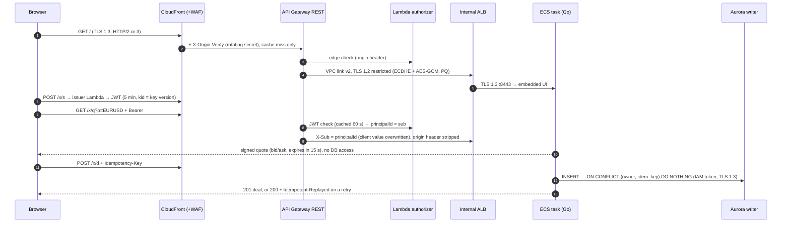

# Architecture

Single AWS account, region `eu-west-3` (Paris), 3 Availability Zones. CloudFront is the only public entry point; the VPC that hosts the API and the database has **no route to the internet**.

## Request flow

## Network

Dedicated VPC `10.20.0.0/16`. The account's default VPC is not used: it has public subnets and an internet gateway by design.

| Tier | CIDR per AZ | Route table | NACL (in / out) | Hosts |
|---|---|---|---|---|
| ingress | /24 | local | in 443 from ingress, ephemeral from app/ingress · out 8443 to app, 443/ephemeral to ingress | internal ALB, VPC link ENIs |
| app | /20 | local + S3 gateway endpoint | in 8443 from ingress, ephemeral · out 443, 5432 to data, ephemeral to ingress | Fargate tasks |
| endpoints | /24 | local | in 443 from app · out ephemeral to app | ECR api/dkr, Logs, Secrets Manager |
| data | /24 | local **only** | in 5432 from app/data · out ephemeral to app/data | Aurora |

- No internet gateway, no NAT gateway, no public IP. The default security group, route table and NACL are locked down by Terraform.
- The app NACL allows 443 out to `0.0.0.0/0` only because the S3 gateway endpoint uses S3 public ranges and NACLs cannot reference prefix lists. With no route out, nothing can actually leave.

### Security groups (SG-to-SG only)

| From | To | Port |
|---|---|---|
| vpclink | alb | 443 |
| alb | api | 8443 (TLS 1.3) |
| api, migrate | db | 5432 (TLS 1.3) |
| api, migrate | endpoints | 443 |
| api, migrate | S3 prefix list | 443 |

`db` has **no egress rule at all**.

## TLS on every hop

| Hop | Policy |
|---|---|
| Browser → CloudFront | `TLSv1.3_2025`: TLS 1.3 only, hybrid post-quantum key exchange, HTTP/2 + HTTP/3 |
| CloudFront → API Gateway | TLS 1.3: the custom domain only accepts `SecurityPolicy_TLS13_1_3_2025_09` (STRICT) |
| API Gateway → ALB | HTTPS, listener `ELBSecurityPolicy-TLS13-1-2-Res-PQ-2025-09`: TLS 1.3 offered, restricted TLS 1.2 accepted because the API Gateway integration client does not negotiate TLS 1.3 (ADR-013). Private hop: VPC link v2 + PrivateLink, SG-to-SG |
| ALB → task | HTTPS, TLS 1.3 only. Self-signed ECDSA certificate generated in memory at start, renewed every 24 h, never stored |
| Task → Aurora | `rds.force_ssl = 1`, `ssl_min_protocol_version = TLSv1.3`, client `verify-full` with the RDS CA bundle baked into the image |
| Task → AWS APIs | VPC endpoints (HTTPS), endpoint policies restricted to the exact calls and resources |

## Encryption at rest & rotation

| Data | Key | Rotation / renewal |
|---|---|---|
| Aurora storage, snapshots, Performance Insights | CMK `soge-data` | key material every 90 days |
| Secrets (JWT key, origin-verify, quote key, DB admin) | CMK `soge-secrets` | JWT 4 h, origin 7 days (Lambda); DB admin 7 days (RDS) |
| CloudWatch Logs (ECS, Lambda, API Gateway, flow logs; edge WAF in us-east-1) | CMK `soge-logs` (+ us-east-1 key) | 90 days |
| Rates snapshot (S3) | CMK `soge-rates` | 90 days |
| Lambda environment, SNS alarm topic | CMK `soge-app` | 90 days |
| Container images (ECR), Terraform state | CMKs (bootstrap) | 90 days |
| Public certificates | ACM, ECDSA P-256, wildcard | auto-renewed |
| Aurora server certificate | `rds-ca-ecc384-g1` | rotated by RDS |
| App → DB credential | IAM auth token | new token per connection (15 min validity) |
| User session | JWT | 5 min, silent renewal at 80% |

KMS material is AWS-generated, not imported (BYOK): see ADR-007.

## Secrets and the Terraform state

| Secret | Created by | In tfstate? |
|---|---|---|
| JWT signing key, origin-verify, quote key | `ephemeral random_password` → `secret_string_wo`, then rotated immediately by Lambda | **no** (only `secret_string_wo_version`) |
| CloudFront origin header | Terraform sets a placeholder; the rotation Lambda pushes the real value | **no** |
| Aurora admin | RDS (`manage_master_user_password`) | **no** |
| App DB credential | none: IAM database authentication | n/a |

Each secret has a resource policy that denies `GetSecretValue` to everyone except its declared readers.

## IAM

- One role per component, exact actions on exact ARNs, no AWS-managed policy on runtime roles.
- Every role carries the bootstrap permissions boundary: no privilege escalation, no IAM users or keys.
- VPC endpoint policies only allow the calls the workload makes, on its own resources.

| Remaining `*` | Why |
|---|---|
| `ecr:GetAuthorizationToken` | The action has no resource type in IAM; pulls are scoped to one repository |
| CI `apply` role = admin within the boundary | Deployment identity; protected environment + reviewers. Next: IAM Access Analyzer-generated policy |
| `Resource "*"` in KMS key policies | Key-policy syntax for "this key", not a wildcard grant |
| `Principal "*"` in Deny statements | Denies everyone except the listed principals; grants nothing |

## Mandatory tags

`Project=soge`, `Environment`, `Owner`, `ManagedBy=terraform`, `Repository=github.com/<owner>/soge` on every taggable resource:

- set through provider `default_tags` (both regions);
- propagated to ECS tasks (`propagate_tags = SERVICE`, managed tags on);
- asserted by a Terraform `check` block;
- enforced in CI by tflint `aws_resource_missing_tags`.

## Observability

- **Logs:** JSON, KMS-encrypted, retention 30–90 days. API Gateway access logs (optional, see README limitations) include TLS version and authorizer error. The API logs a pseudonymised subject (SHA-256 prefix), never a token.
- **Metrics:** AWS metrics plus business metrics through CloudWatch EMF (no agent): deals executed, rate-snapshot failures.
- **Traces:** not enabled (cost, scope); listed in next steps (OpenTelemetry). Correlation today: timestamp + pseudonymised subject across WAF logs, Lambda logs and API logs.
- **Alarms:** ALB 5xx ratio and p95, API Gateway 5xx, Lambda errors, Aurora ACU, rates freshness. A composite SLO alarm drives ECS deployment rollback.
